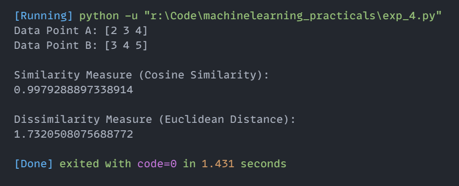

# Experiment 4: Similarity and Dissimilarity Measures (Cosine Similarity & Euclidean Distance)

## Aim
Implementation and demonstration of Similarity and Dissimilarity Measures (Cosine Similarity & Euclidean Distance) using Python.

## Program Information
- **File**: `exp_4.py`
- **Language**: Python 3
- **Libraries**: `numpy`, `sklearn.metrics.pairwise`, `scipy.spatial.distance`

## Output

