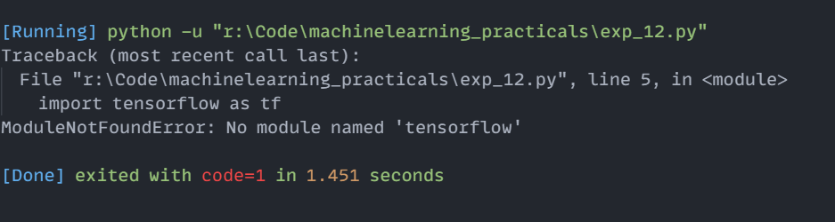

# Experiment 12: Machine Learning Libraries Overview (NumPy, Pandas, Scikit-learn, TensorFlow)

## Aim
Implementation and demonstration of Machine Learning Libraries Overview (NumPy, Pandas, Scikit-learn, TensorFlow) using Python.

## Program Information
- **File**: `exp_12.py`
- **Language**: Python 3
- **Libraries**: `numpy`, `pandas`, `sklearn.linear_model`, `tensorflow`

## Output

