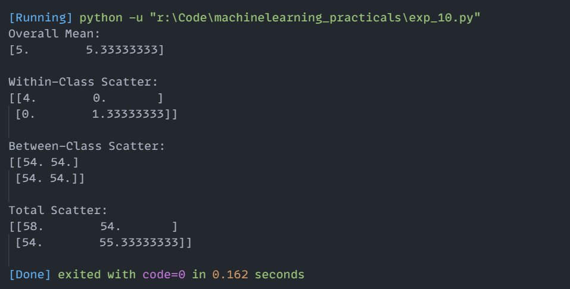

# Experiment 10: LDA Scatter Matrices (Within-Class, Between-Class & Total Scatter)

## Aim
Implementation and demonstration of LDA Scatter Matrices (Within-Class, Between-Class & Total Scatter) using Python.

## Program Information
- **File**: `exp_10.py`
- **Language**: Python 3
- **Libraries**: `numpy`

## Output

