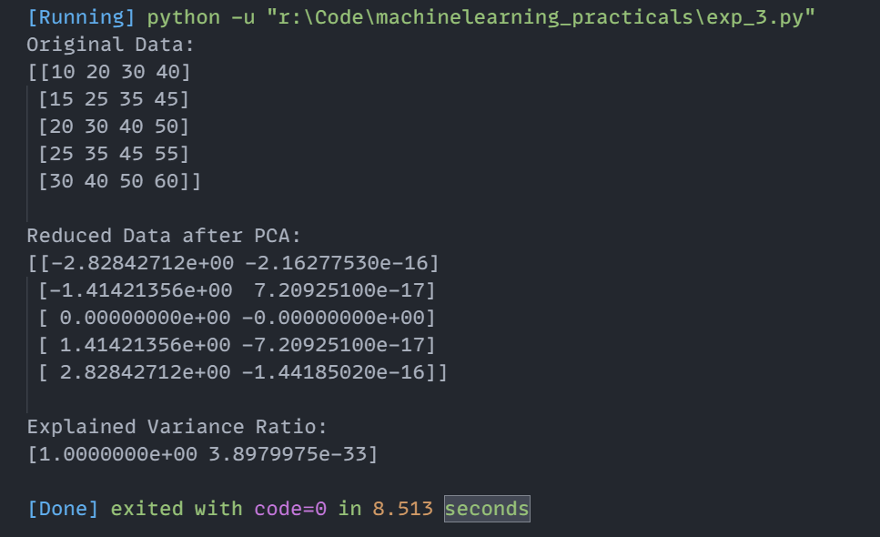

# Experiment 3: Principal Component Analysis (PCA)

## Aim
Implementation and demonstration of Principal Component Analysis (PCA) using Python.

## Program Information
- **File**: `exp_3.py`
- **Language**: Python 3
- **Libraries**: `numpy`, `sklearn.preprocessing`, `sklearn.decomposition`

## Output

