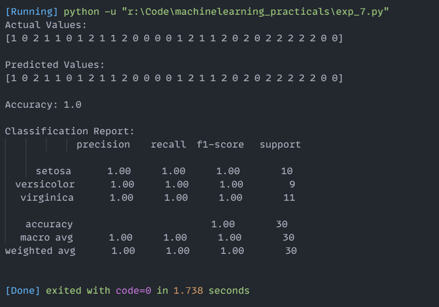

# Experiment 7: k-Nearest Neighbors (k-NN) Classification

## Aim
Implementation and demonstration of k-Nearest Neighbors (k-NN) Classification using Python.

## Program Information
- **File**: `exp_7.py`
- **Language**: Python 3
- **Libraries**: `sklearn.datasets`, `sklearn.model_selection`, `sklearn.neighbors`, `sklearn.metrics`

## Output

