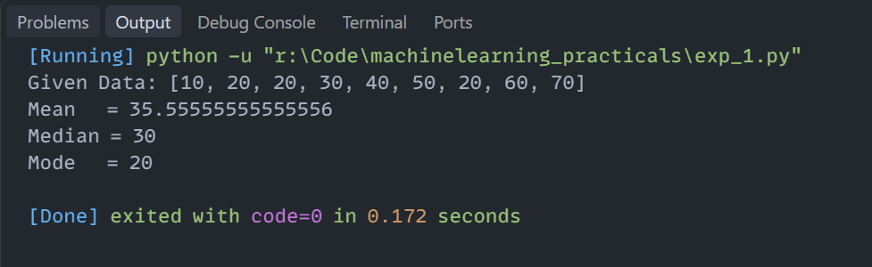

# Experiment 1: Measures of Central Tendency (Mean, Median, Mode)

## Aim
Implementation and demonstration of Measures of Central Tendency (Mean, Median, Mode) using Python.

## Program Information
- **File**: `exp_1.py`
- **Language**: Python 3
- **Libraries**: `statistics`

## Output

