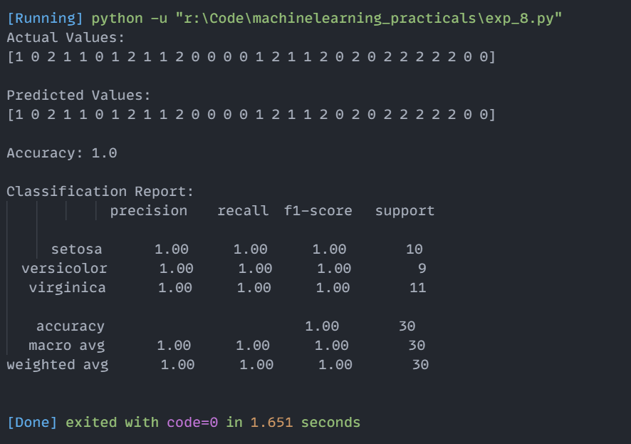

# Experiment 8: Decision Tree Classification

## Aim
Implementation and demonstration of Decision Tree Classification using Python.

## Program Information
- **File**: `exp_8.py`
- **Language**: Python 3
- **Libraries**: `sklearn.datasets`, `sklearn.model_selection`, `sklearn.tree`, `sklearn.metrics`

## Output

