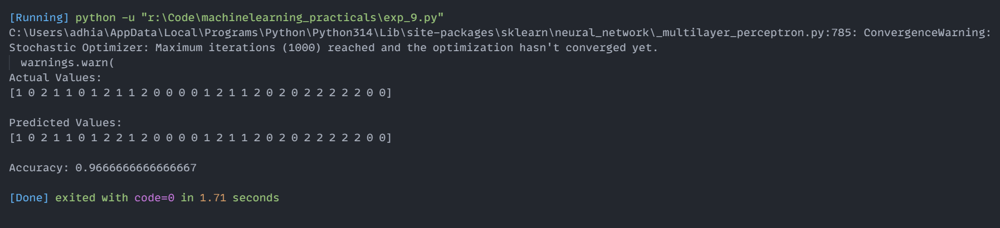

# Experiment 9: Multi-Layer Perceptron (MLP) Neural Network Classification

## Aim
Implementation and demonstration of Multi-Layer Perceptron (MLP) Neural Network Classification using Python.

## Program Information
- **File**: `exp_9.py`
- **Language**: Python 3
- **Libraries**: `sklearn.datasets`, `sklearn.model_selection`, `sklearn.neural_network`, `sklearn.metrics`

## Output

