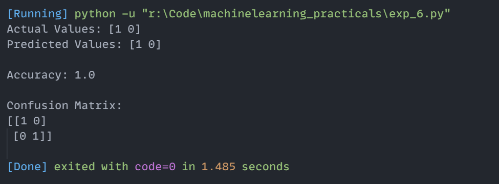

# Experiment 6: Logistic Regression Classification

## Aim
Implementation and demonstration of Logistic Regression Classification using Python.

## Program Information
- **File**: `exp_6.py`
- **Language**: Python 3
- **Libraries**: `numpy`, `sklearn.linear_model`, `sklearn.model_selection`, `sklearn.metrics`

## Output

