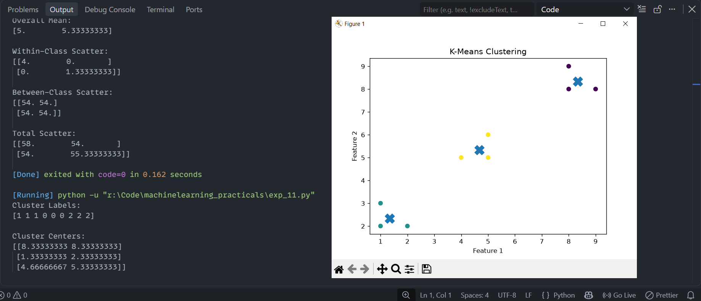

# Experiment 11: K-Means Clustering

## Aim
Implementation and demonstration of K-Means Clustering using Python.

## Program Information
- **File**: `exp_11.py`
- **Language**: Python 3
- **Libraries**: `numpy`, `matplotlib.pyplot`, `sklearn.cluster`

## Output

