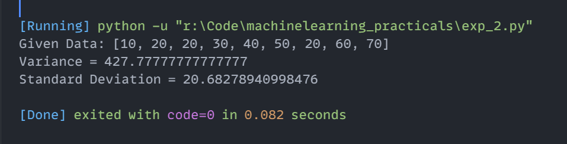

# Experiment 2: Measures of Dispersion (Variance and Standard Deviation)

## Aim
Implementation and demonstration of Measures of Dispersion (Variance and Standard Deviation) using Python.

## Program Information
- **File**: `exp_2.py`
- **Language**: Python 3
- **Libraries**: `statistics`

## Output

